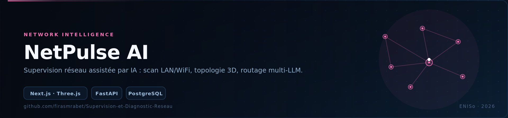
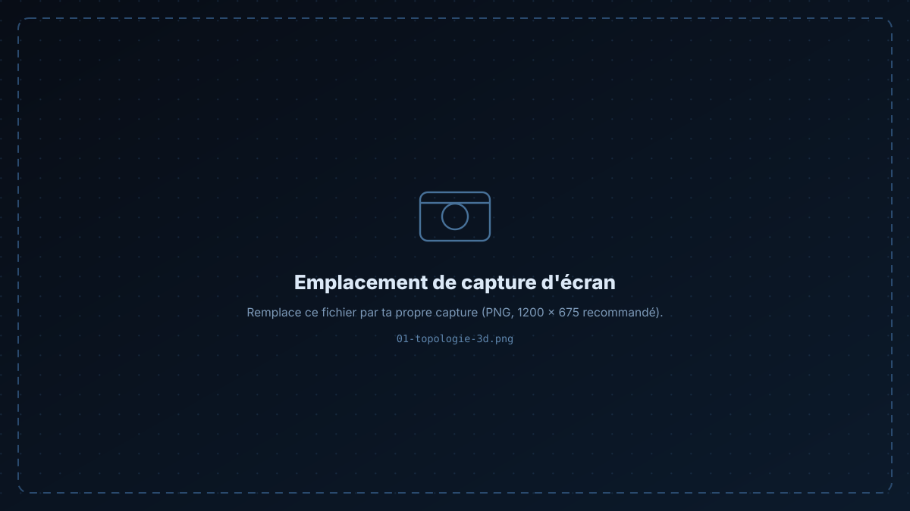
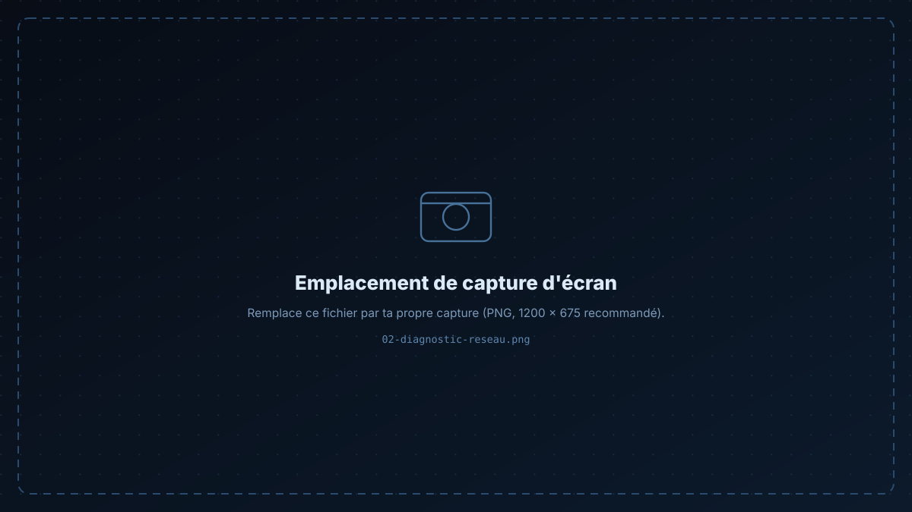

<p align="center">
  
</p>

<p align="center">
  
  
  
  
  
  
</p>

<h1 align="center">NetPulse AI</h1>

<p align="center">
Une console d'exploitation réseau qui <b>découvre</b> le LAN, le <b>rend en 3D</b>, le <b>diagnostique</b> en temps réel<br/>
et route chaque question vers le meilleur LLM disponible.
</p>

<p align="center">
  <a href="#-fonctionnalités">Fonctionnalités</a> ·
  <a href="#-architecture">Architecture</a> ·
  <a href="#-démarrage">Démarrage</a> ·
  <a href="#-routage-ia">Routage IA</a>
</p>

---

## 📸 Captures

> Remplace les deux emplacements ci-dessous par tes captures, puis mets à jour les chemins.

<p align="center">
  
  
</p>

---

## ✨ Fonctionnalités

- **🧊 Topologie 3D interactive** — nœuds, passerelles, serveurs, postes de travail, capteurs IoT et pare-feu rendus en temps réel avec des tubes de flux animés et des shaders PBR (Three.js / React Three Fiber).
- **📡 Découverte LAN & WiFi** — découverte matérielle des équipements via **ARP** et **BSSID 802.11**, avec suivi de latence et de bande passante.
- **🧠 Moteur IA multi-fournisseurs** — un routeur de requêtes unique vers **8 fournisseurs LLM** : Mistral, Groq, Cerebras, SambaNova, Cohere, NVIDIA NIM, OpenRouter et GitHub Models.
- **🔐 Double authentification** — identifiants JWT chiffrés en local *et* Google OAuth 2.0 (GSI / FedCM).
- **📈 Diagnostic temps réel** — graphes de débit, inspection des pertes de paquets et alertes d'anomalies.
- **🗄 Analytique persistante** — PostgreSQL pour la télémétrie historique et la journalisation d'audit.

---

## 🏗 Architecture

```
├── src/                      # frontend Next.js 16 (App Router)
│   ├── app/                  # Dashboard · Network · AI Chat · Reports · Settings · Login
│   ├── components/           # UI, providers, visualiseur 3D (Three.js / R3F)
│   ├── lib/                  # client API & helpers
│   └── types/                # définitions TypeScript
├── backend/                  # service FastAPI
│   ├── main.py               # endpoints REST
│   ├── ai_router.py          # moteur LLM multi-fournisseurs
│   ├── network_scanner.py    # découverte ARP & WiFi
│   ├── auth.py               # JWT + Google OAuth
│   ├── database.py           # SQLAlchemy / PostgreSQL
│   └── models.py             # schémas
└── docs/
```

```
Navigateur ──▶ Next.js (app router) ──▶ FastAPI ──┬──▶ scanner ARP / 802.11
                                                  ├──▶ PostgreSQL (télémétrie, audit)
                                                  └──▶ routeur LLM ──▶ 8 fournisseurs
```

---

## 🚀 Démarrage

### 1 — Backend

```bash
cd backend
python -m venv venv
source venv/bin/activate          # Windows : .\venv\Scripts\activate
pip install -r requirements.txt
python main.py                    # → http://localhost:8000
```

### 2 — Frontend

```bash
npm install
npm run dev                       # → http://localhost:3000
```

### 3 — Configuration

```bash
cp .env.example .env       # racine
cp .env.example .env       # backend/
```

Renseigne au minimum une clé d'API LLM (Groq est la plus rapide à obtenir), l'URL PostgreSQL et — si tu actives la connexion Google — l'identifiant client OAuth.

> 🔎 Le scan du réseau local nécessite les privilèges de socket brut : lance le backend avec les capacités requises (`sudo` sous Linux/macOS), sinon le scanner renverra un réseau vide.

---

## 🧠 Routage IA

`backend/ai_router.py` maintient une table de fournisseurs et bascule automatiquement :

1. la requête est classée (diagnostic / configuration / rapport / général) ;
2. les fournisseurs sont essayés par priorité, avec **timeout** et repli sur erreur ;
3. chaque réponse conserve son **fournisseur d'origine**, affiché dans l'interface.

Ajouter un fournisseur = implémenter une fonction et l'enregistrer — aucune modification côté frontend.

---

## 🛠 Stack

**Frontend** Next.js 16 · React · TypeScript · Tailwind CSS · Three.js / R3F
**Backend** FastAPI · SQLAlchemy · PostgreSQL · JWT · Google OAuth 2.0
**Ops** découverte ARP / 802.11 · routage multi-LLM

---

<div align="center">

**Firas Mrabet** — Élève ingénieur en informatique appliquée @ ENISo

[GitHub](https://github.com/firasmrabet) · [LinkedIn](https://www.linkedin.com/in/firas-mrabet-98779934b) · [Portfolio](https://firas-mrabet-portfoliowebsite.vercel.app) · [Email](mailto:firasmrabet1603@gmail.com)

</div>
